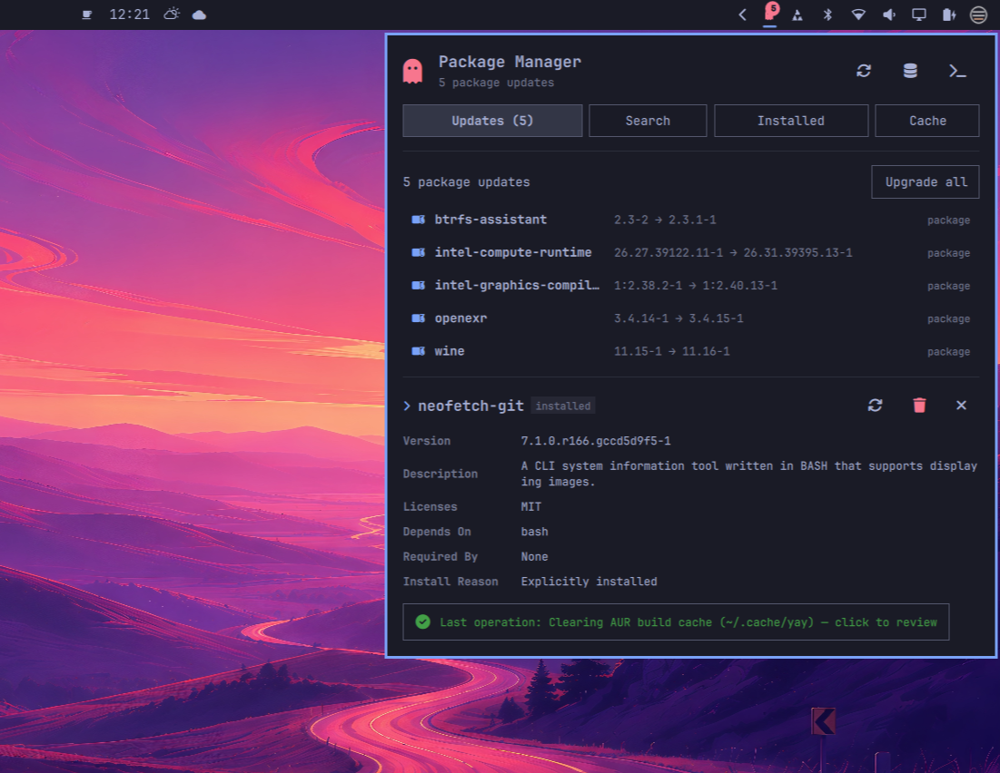
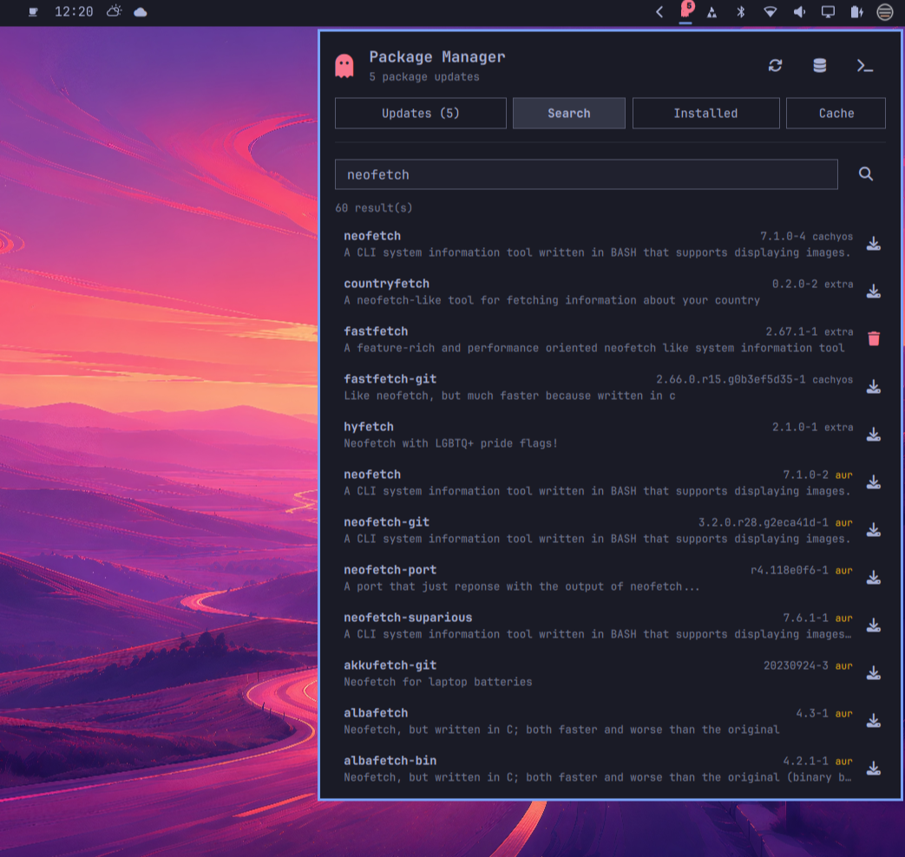
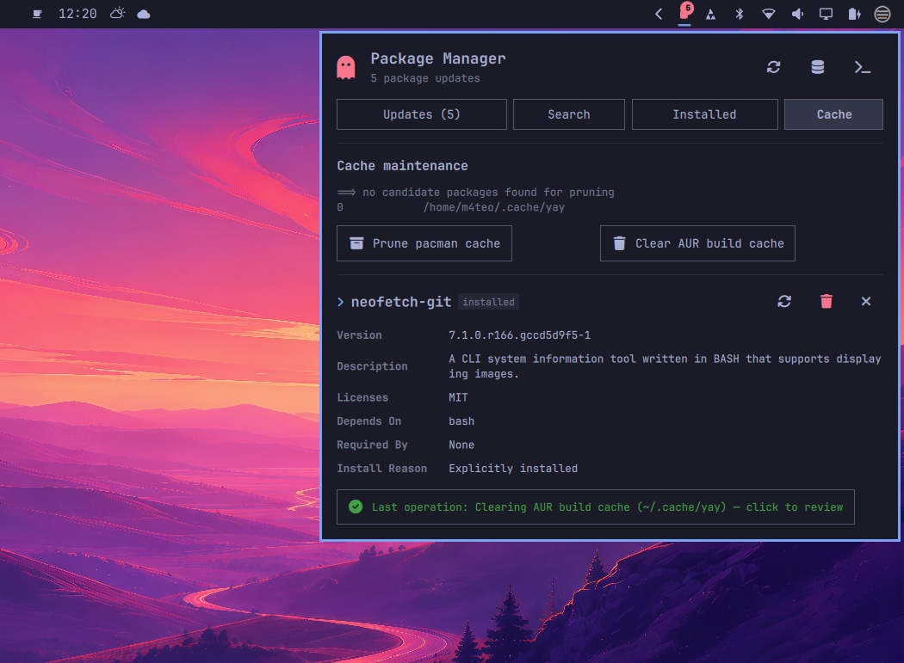

# Pacman for Omarchy

A package manager living in the Omarchy bar: pacman update notifier, package search, install/remove actions that open in your system's default terminal, and cache cleaning.







## Features

- **Bar widget** — ghost icon with an update-count badge that turns urgent-colored while updates are pending. Click to open the panel.
- **Updates tab** — lists pending repository updates with current → new versions; *Upgrade all* hands off to Omarchy's official updater (`omarchy-update`) in a floating terminal, and a separate button syncs the package databases (`pacman -Sy`) in a terminal.
- **Search tab** — opens with an alphabetical index of official repo packages; filters live as you type with exact-name matches on top, shows installed state and lets you install or remove any result.
- **Installed tab** — browse your native packages, jump straight to details, remove packages.
- **Cache tab** — clean the pacman package cache (`paccache`, keeping your chosen number of old versions).
- **Privileged actions run in a terminal** — install, remove, reinstall, database sync and cache pruning open in your default terminal (the same floating terminal style as Omarchy's updater). The command runs under `sudo`, so the root password is requested right there in the terminal; output streams there and `Ctrl+C` stops it.
- **Details view** — description, version, repository, install reason, dependencies, reverse dependencies and licenses for any package.

All colors follow your active Omarchy theme tokens.

## Requirements

| Dependency | Required | Used for |
|---|---|---|
| Omarchy | yes | Shell / Quickshell bar with the plugin system |
| `pacman-contrib` | yes | `checkupdates` and `paccache` |
| `sudo` | yes | Root password prompt for install/remove/sync/cache (inside the terminal) |

## Installation

```sh
omarchy plugin add https://github.com/archlatam/arch.iudc.git --enable
```

Then add the widget from the shell config if it is not enabled automatically (bar section `right` by default).

## Update

```sh
omarchy plugin update arch.iudc
```

After updating, reload the Omarchy shell so the new version takes effect.

## Removal

```sh
omarchy plugin remove arch.iudc
```

## Settings

Configurable through the Omarchy plugin settings UI:

| Setting | Type | Default | Description |
|---|---|---|---|
| `refreshIntervalSec` | integer (300–21600) | `1800` | How often update checks run |
| `cacheKeepVersions` | integer (1–5) | `2` | Old package versions kept when cleaning cache |

## Keyboard shortcuts

While the panel is open:

| Key | Action |
|---|---|
| `Esc` | Close the panel |
| `r` | Check for updates |
| `u` | Open Omarchy's updater (full system upgrade) |
| `1`–`4` | Switch to Updates / Search / Installed / Cache tab |

## IPC control

Scriptable from the terminal or keybinds:

```sh
omarchy-shell arch.iudc toggle    # open/close the panel
omarchy-shell arch.iudc refresh   # force an update check
omarchy-shell arch.iudc upgrade   # open Omarchy's updater
omarchy-shell arch.iudc open      # open without toggling
omarchy-shell arch.iudc close     # close
omarchy-shell arch.iudc show      # alias of open
omarchy-shell arch.iudc hide      # alias of close
```

## How privileges work

Every privileged action (install, remove, reinstall, `pacman -Sy`, `paccache`) is launched in your default terminal as `sudo <pluginDir>/iudc-run <mode> …`. The terminal itself asks for your root password before anything runs; no password is ever read, stored or transmitted by this plugin, and the bar process never runs anything as root. Read-only queries (update check, search, package details, installed list) run unprivileged as your user.

Nothing is downloaded or executed from third-party URLs; all commands operate exclusively on your configured pacman repositories.

## License

[MIT](LICENSE) © 2026 m4teo
